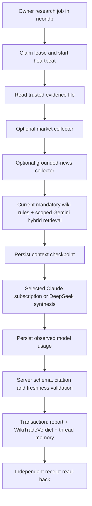

# Research orchestration, freshness and database access

Updated 8 October 2026. Local code is implemented; production deployment and worker
activation remain separate. No production rows or provider configuration were changed
by this follow-up.

## Why VKTX incorrectly looked current

The October 5 screenshot matched the Gemini `MorningBriefCache` row generated at
14:49:09 UTC: VKTX +35.67%, RVOL 16.2x. The card's “2m ago” meant the brief was stored
recently. It did not establish when its underlying market data was observed. The exact
historical input that supplied those numbers was not retained/proven.

The repair checks both ends:

- Snapshot composition excludes missing, invalid, prior-session or over-one-hour static
  inputs; live quotes retain their stricter existing freshness rule.
- Generated mover values are reconciled to observed per-symbol evidence, with source
  and timestamp. Model-written price changes cannot establish their own accuracy.
- Unverified analysis, directional labels, scores and unsupported narratives are not
  promoted into Live Ideas. External brief ingestion cannot self-assert verified source
  metadata. Older briefs remain separate from the validated live projection.
- API reads and provider selection recheck observation age. The card uses observation
  time; a new cache write or re-ingestion cannot make an old quote fresh.

Without current evidence the panel shows unavailable, rather than replacing +35.67%
with another guessed number. This local fix must be deployed before the hosted dashboard
changes. It does not refresh upstream screeners or constitute a completed morning daily.

## LangGraph adoption

The Python worker now executes real LangGraph nodes through `workflow.py`:



This is an explicit research workflow, with one selected synthesis provider per job.
It does not pretend that seven independent LLM agents now run. Existing collectors,
mandatory doctrine and report sections remain the specialist inputs. LangGraph does
not silently choose another model or manufacture absent evidence.

`ResearchJob`/`ResearchThread` retain durable queue/thread authority. A new lease starts
a fresh graph and reloads evidence. There is no second LangGraph checkpoint database,
mid-node crash resume, or automatic retry of a provider call. Heartbeat cancellation,
receipt-first completion recovery and the three-attempt transaction-conflict limit
remain enforced. LangSmith tracing is disabled explicitly to avoid exporting context.

## Where the data is stored

| Store | Database/schema | Tables or files | Purpose |
|---|---|---|---|
| Dashboard Neon PostgreSQL | `neondb.public` | `MorningBriefCache`, `WikiTradeVerdict`, `LiveQuote`, `Position`, journal/trade tables | Briefs, analysis and application data |
| Research queue migration | Intended `neondb.public` | `ResearchJob`, `ResearchThread` | Local schema exists; both tables were absent in the October 8 live metadata check |
| Gemini vector mirror | Separate Neon database `wiki_rag`, schema `public` | `wiki_index_generation`, `wiki_chunk`, view `wiki_chunk_active` | Source passages, vector(768), provenance and active generation |
| Local Gemini index | Canonical `jie_wiki/scripts/retrieval/.index-gemini/` | `index.zip` contains `manifest.json`, `vectors.npy`, `receipt.json` | Local source index mirrored into Neon |

Live read-back on October 8: `wiki_rag` has pgvector 0.8.0, active generation 1,
850 chunks, `gemini-embedding-001`, 768 dimensions. It was loaded October 6 at
04:29:45 UTC. **Existence is not freshness:** current source-hash validation fails
because `agent-system/board.md` and the pgvector task record changed after that snapshot.
The research worker stops on this mismatch before a query embedding/provider call.
It never silently substitutes the local index or keyword mode.

Claude's separately approved wiki task installed pgAdmin and created the Neon mirror.
Its implementation is in wiki commit `78c369c`; this dashboard change consumes the
canonical loader read-only. Refreshing the local index and publishing a verified new
mirror generation belong to the controlled wiki refresh process, not worker reads.

## Open both databases in pgAdmin

pgAdmin 4 **9.18 is installed** at:
`%LOCALAPPDATA%\Programs\pgAdmin 4\runtime\pgAdmin4.exe`.

A new password-free import file is prepared at:
`%LOCALAPPDATA%\Jie\database-viewer\pgadmin-servers.json`.

1. Open pgAdmin, then **Tools → Import/Export Servers → Import** and select that file.
2. Expand group **Jie - Neon**. It contains **Neon - Market Dashboard** (`neondb`) and
   **Neon - Wiki Gemini Vectors** (`wiki_rag`).
3. Supply the existing database password when prompted. The import deliberately does
   not copy passwords. App credentials are in the dashboard's local environment;
   the mirror connection is in `%LOCALAPPDATA%\Jie\secrets\wiki-rag.env`.
4. Expand **Databases → database name → Schemas → public → Tables / Views**.

Both definitions require TLS and request `default_transaction_read_only=on`. This is a
session default, not a new restricted database role. Do not disable it for inspection.
The file has been read back; the interactive pgAdmin login/import was not performed.

Useful read-only SQL in `wiki_rag`:

```sql
SHOW transaction_read_only;
SELECT generation_id, model, chunk_count, active, loaded_at, verified_at
FROM public.wiki_index_generation ORDER BY generation_id DESC;
SELECT path, start_line, end_line, left(text, 240) AS passage,
       vector_dims(embedding) AS dimensions
FROM public.wiki_chunk_active ORDER BY path, start_line LIMIT 50;
```

In `neondb`, view brief storage times without exposing personal trading records:

```sql
SELECT provider, "bucketAt", "generatedAt", "errorMsg" IS NOT NULL AS failed
FROM public."MorningBriefCache" ORDER BY "generatedAt" DESC LIMIT 20;
```

## Worker setup and retrieval selection

From the repository root:

```powershell
python -m venv packages/research-worker/.venv
packages/research-worker/.venv/Scripts/python.exe -m pip install -r packages/research-worker/requirements.txt
# Configuration check only; no job claim, query embedding or generation.
packages/research-worker/.venv/Scripts/python.exe packages/research-worker/worker.py --provider claude --retrieval hybrid --wiki-store pg
```

For an authorized configured run, add `--execute --once`. `--wiki-store pg` requires
`--retrieval hybrid`; local lexical remains the explicit default. Gemini embeds the
question while Claude/DeepSeek sees selected passage text, not numeric vectors. Current
full mandatory rules load deterministically; scope filtering occurs before supplemental
ranking. Private thread memory stays in the dashboard, outside the shared vector index.

## Validation and remaining work

October 8 results: **426 app tests passed, 15 integration tests skipped; 44 Python
tests passed; TypeScript, strict skill-sync and diff checks passed.** The final 20
focused freshness tests also passed after the type fixes. An independent code review
found no blocking issues. The October 5 real PostgreSQL/Claude smoke predates this
LangGraph integration; no new live graph-to-provider-to-database run was performed.

Real LangGraph workflow execution, provider/lease isolation, scope-before-ranking and
canonical freshness checks are covered by the Python suite. App regressions cover
snapshot → cache ingestion → API projection → provider selection, including the VKTX
unsupported-value case, stale re-ingestion and duplicate screener/watchlist symbols.

Production still needs the research migration, owner/token/model configuration and
deployment. Hybrid end-to-end acceptance needs a current verified vector generation.
Authenticated charts, complete structural action gates and bot delivery remain separate;
GO/PROBE are blocked. No paid generation or embedding refresh was performed in this pass.

Temporary smoke-server cleanup was previously blocked by execution policy even after
Jie's permission. Consent is already recorded; changing or bypassing a managed denial
is not something the agent can grant itself. The stopped temporary folder, if retained,
is `%TEMP%\research-smoke-20261005`.

References: [LangGraph workflows](https://docs.langchain.com/oss/python/langgraph/workflows-agents),
[persistence](https://docs.langchain.com/oss/python/langgraph/persistence),
[pgAdmin Windows](https://www.pgadmin.org/download/pgadmin-4-windows/),
[Codex command rules](https://learn.chatgpt.com/docs/agent-configuration/rules).
