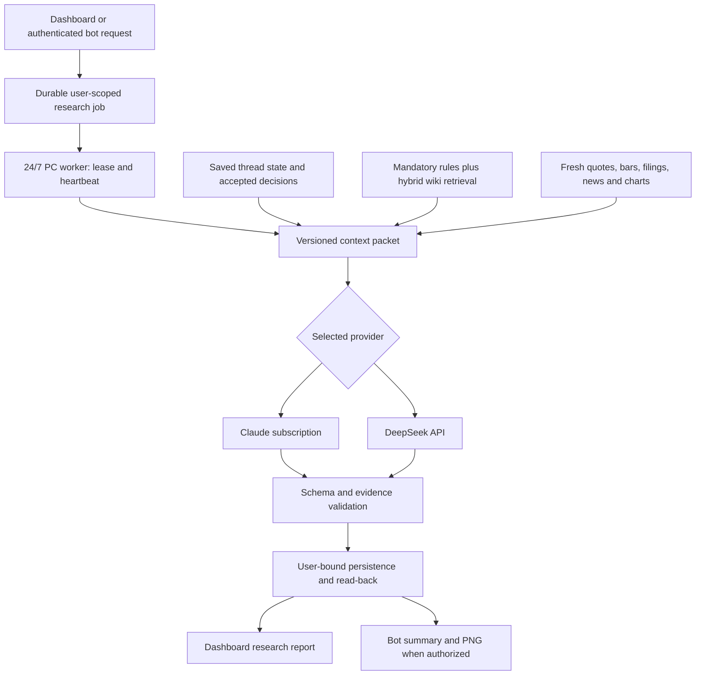

# Stateful research: dashboard, Claude and DeepSeek

Status: 8 October 2026. Report-correctness repairs and the first local stateful research
implementation are present. The design below now has schema/context, durable owner-only
jobs, Claude/DeepSeek adapters, optional collectors and a saved-report dashboard view.
Production remains disabled. The research migration and two Claude subscription turns
passed against isolated local PostgreSQL on 5 October; no production migration,
deployment, bot restart, paid API analysis, embedding refresh or message was performed.

## Implementation update

The worker now uses real LangGraph nodes while retaining the existing PostgreSQL
job/thread state, leases and receipt checks. Gemini hybrid retrieval can explicitly
use the Neon `wiki_rag` mirror; it fails on stale corpus hashes with no backend fallback.
The October 8 read-back found 850 vector chunks, but two changed wiki files invalidate
that generation. Production still lacks `ResearchJob` and `ResearchThread` tables.
The October 5 live smoke below predates LangGraph; it is not a live graph acceptance test.
See [current architecture, database viewer and activation boundaries](research-orchestration-and-data-access.md).

See [worker setup and limits](../packages/research-worker/README.md). Report validation
lives in `apps/market_dashboard/src/lib/research/schema.ts`; jobs and transactional
analysis ingestion in `src/server/research-jobs.ts`; authenticated routes under
`/api/research`; local context/providers/collectors in `packages/research-worker`.
The SQL migration passed locally; it has not been applied to production. The old analysis UI remains the default;
the new UI is behind NEXT_PUBLIC_FEATURE_RESEARCH_WORKER and RESEARCH_ENABLED.

The worker implements outbound claim/heartbeat/checkpoint/complete/receipt, bounded
crash recovery, cancellation and exact thread-bound Claude resume. Seven full mandatory
wiki documents and pre-ranking trading filters prevent unrelated wiki material entering
the prompt. Lexical retrieval is explicitly labelled; hybrid never repairs the index.
Optional Yahoo evidence and Gemini search-supported news preserve gaps on failure.

Independent review found missing source-type/ticker/age and risk-level checks; these
were repaired with regressions. GO/PROBE remain rejected because a model boolean cannot
replace the complete deterministic structural-veto evaluator. Unsupported scores,
financial grades and price plans cannot masquerade as complete research.

The [5 October smoke validation](research-worker-smoke-2026-10-05.md) closes the local
PostgreSQL concurrency/rollback and subscription transport/session/ingest checks. Two
Claude turns persisted partial reports and reused the exact saved session. A temporary
completion-conflict recovery bug was repaired with bounded same-report retries.
Validation: 427 app tests across 53 files, one separately passed two-turn Claude test,
29 Python tests, TypeScript and strict skill-sync freshness pass.

Still outstanding: staging/production activation, authenticated browser acceptance, a
fresh live-evidence report, full structural action gates, automated authenticated chart
capture and bot submission/PNG integration. Local smoke success does not enable the
24/7 service. The remaining design describes those unfinished behaviors.

## The report Jie already specified

One sourced ticker report should serve all channels. The channel changes presentation,
not the evidence or scoring rules. Seven thin placeholder cards are not that report.

| Order | Required content | Existing contract |
|---|---|---|
| 1 | Latest major catalyst: event date, decisive facts, stock reaction/window, direct link; next verified catalyst/date/distance | jie_wiki/skills/trade-analyser/references/mode-b-analysis.md:8-24 |
| 2 | ELI12 business explanation, professional summary, major clients, durability/moat | Mode B:28-40; packages/bot-box/private-bot-prompt.md:57-60 |
| 3 | Named peers and relative strength over a stated period; sector context | Mode B:61-72 |
| 4 | Fundamentals with sources/reporting periods; growth, profitability, valuation and balance sheet; parallel A/B/C rubric | wiki/trading/concepts/fundamental-analysis.md:15; Mode B:61-72 |
| 5 | Seven trader lenses and evidence; Conviction Setup/40 + Entry/30 + Theme/20 + Sentiment/10; daily/weekly charts | Mode B:42-53,61-72; skills/trade-analyser/references/wiki-pages-to-load.md:49-78 |
| 6 | Action, trigger, entry, stop, invalidation, target, sizing consequence and blockers | Mode B:61-72; bot prompt:57-60 |

News must cover three months' material events, insider/institutional activity,
next-30-day catalysts, analyst changes and explanations of large moves. Failed feeds
mean unknown coverage, not no news. Distinguish fact, source claim and inference.
Separate a company event from a peer-driven catalyst.

Dashboard: readable sections with sources and timestamps. Discord: short summary
plus the existing rendered PNG report, never an HTML attachment. Missing sections stay
visible as unavailable. No GO without required usable daily and weekly chart evidence.

## Verified existing capabilities and gaps

- Bot runs Claude subscription with a restricted runner and Discord channels. In
  botrun.py:139-167, wiki_rag uses Gemini hybrid retrieval with --no-repair; wiki_search
  provides keywords. lib/refresh-repos.ps1:62-81 refreshes embeddings hourly. These are
  implemented paths, not proof of current host uptime.
- The retrieval README's older claim that no automatic integration exists is superseded
  for this bot by those call sites. The dashboard multi-agent route still lacks RAG.
- Historical October 4 local index metadata: 268 documents, 835 sections, 768 dimensions,
  gemini-embedding-001, built/refreshed 2026-10-03T17:57:50Z. Status verifies stored
  identity/integrity, not current-corpus freshness or retrieval quality. This review
  used keyword-only searches; no embedding API requests were made.
- The corpus includes allowed tracked wiki/skill/task/control Markdown. It excludes
  untracked drafts, private paths, raw evidence, other repositories and Discord chat.
- start-private-bot.ps1:146 has no resume/continue option. A recorded session ID supports
  operational/idle information; no inspected custom restart-to-conversation mapping
  restores research threads. Wiki document retrieval is not conversation memory.
- The legacy /api/analysis/multi-agent is synchronous and returns unpersisted JSON. News, chart
  and history are stubs; fundamental/technical are older implementations; the moderator
  is arithmetic. The new feature-gated /api/research path now supplies durable jobs.
- WikiTradeVerdict(intent="analysis") already stores ad-hoc research. The stock-analysis
  route demonstrates user binding and journal-collision protection. Existing subscription
  brief dispatch can start a runner, but HTTP 204 proves dispatch only.
- Bot publication/ingestion is currently restricted. A new worker needs narrowly scoped
  result submission reviewed separately; do not make the existing bot an unrestricted writer.

## Local report repairs

Missing NTAP data plus two neutral/50 fallbacks previously produced HOLD/confidence8.
Unavailable provenance now prevents those fallbacks from being completed analysis;
malformed provider JSON cannot pass. Missing financial values are unavailable in model
inputs, not zero. Nested financial metrics and explanations now survive adaptation.

Legacy results remain visibly partial because they lack the full source/period, chart,
news and canonical scoring contracts. Technical still uses six personas and indicator
proxies; those limitations are explicit. Its ATR proxy is not used for risk sizing.

Required missing sections block a final verdict. Failed votes are excluded; there is
no default HOLD. Missing snapshots, timestamps more than five minutes in the future, and snapshots older than 180 minutes are not used.
Risk requires actual snapshot price and ATR; the invented $100 entry is removed.
Default $10,000 sizing is labelled illustrative, not broker equity. A new request clears
the previous result, so a failed ticker cannot retain the prior ticker's report.

The legacy path is a truthful interim display. The new worker remains research-only. Historical/weekend
review needs a separate explicit as-of mode, not a relaxed current-run gate. Partial
legacy reports are not automatically ingested as final research.

## Recommended shared workflow

Use outbound HTTPS polling from the PC, not an inbound shell port. Dashboard returns
jobId/queued promptly; the worker loads its local wiki index and tools. Vercel need not
access Windows paths or the index ZIP. PC commands and UI requests enter one workflow.

Implemented job fields follow this design: id, userId, threadId, ticker, horizon, asOf, provider,
schemaVersion, promptVersion, state, attempt, leaseOwner/expiry, heartbeatAt, inputHash,
resultId, errorCode and timestamps. States: queued/running/succeeded/partial/failed/
expired/cancelled. A model reply is not success until validation and ingest read-back.

Use atomic leases, bounded retries and a hard deadline. Idempotency prevents duplicate
results; reject completion from expired/replaced leases. Bind owner, ticker, provider
and as-of to the stored job. Accept parameters, never arbitrary shell commands or paths.
An offline PC leaves queued/expired status, never a successful-looking substitute.

Keep job/state separate from WikiTradeVerdict. Model final ingest on /api/analysis/stock
with its user binding and journal-intent safeguards. Do not blindly use wiki-audit
upserts that can change intent. Review versioned report persistence (JSON extension
versus a new report table) before applying any schema migration. The authored migration
adds ResearchJob and ResearchThread; each job stores its immutable report JSON, while
WikiTradeVerdict stores the latest analysis for the mapped operator/date/ticker.

## How embeddings enrich the prompt

Vectors select relevant passages. Claude/DeepSeek receive the text, not numeric vectors.
Gemini can remain the embedding provider while either model generates the report.
Retain the existing local index initially; no vector-database migration is necessary
for this single-worker design. The existing schema.sql is a sketch, not deployed pgvector.

Build one auditable context packet in this order:

1. Stable system policy: role, schema, source precedence, no invented data, freshness/GO
   gates, citation rules, provider and tool limits. Compact and versioned, not the whole wiki.
2. Mandatory doctrine: current exact sections from trader-styles, fundamental-analysis,
   ticker-catalyst-analysis, risk-management and relevant chart/entry rules. Load
   deterministically; similarity ranking must not decide whether a hard gate is present.
3. Thread state: intent/horizon, accepted decisions, open questions, previous result ID
   and compact source-linked summary, with version and as-of time.
4. Retrieved evidence: relevant wiki sections and separately scoped prior analyses,
   each with path/lines, content hash, revision, retrieval time and status.
5. Live evidence: market timestamps, financial periods, event URLs/dates, chart evidence,
   retrieval times and coverage gaps.
6. Current question and required output. Retrieved text is evidence, not instructions
   that may change permissions, send messages or override the report contract.

Start with six supplemental snippets after mandatory doctrine, then measure coverage
and tokens. Preserve rule thresholds when selecting sections. Hybrid search combines
exact tickers/rule names with semantic paraphrases. Similarity is not confidence.

Filter scope before ranking: only trading doctrine and approved project contracts may
enter the trading worker. The global index also contains unrelated project records;
its CLI alone does not establish dashboard data-access policy. Add an allowlisted
corpus/metadata filter or a separate trading index before automatic adoption. A prompt
asking the model to ignore unrelated/private material is not access control.

Keep private conversation state user-scoped. Later memory embeddings should have a
separate namespace with owner/thread/retention filters; never mix raw Discord chat
into the shared doctrine index. Store source/model/dimensions/chunker identity and
hashes. Read paths use --no-repair; a controlled refresher updates changed sources
atomically. On stale index or missing key, explicitly report unavailable retrieval or
label current keyword evidence. Never claim semantic success after fallback.

## Stateful Claude versus DeepSeek

Claude subscription: retain the established subscription-only runner policy. Capture
session_id and bind it to owner/thread/provider/promptVersion. Resume that exact ID,
not globally the latest session. Save a portable summary and evidence IDs separately
so compaction/restart/host migration does not depend solely on transcripts. Reload
current rules and live evidence each turn. Old prices in resumed context are history.
Claude desktop, Code and bot sessions are not automatically shared.

DeepSeek API: persist messages and a compact thread summary in application storage;
assemble the same context packet each call. Prefix caching can reduce repeated-input
cost, but it is not memory or authorization. Put stable policy/schema/doctrine first,
changing state/evidence/request afterward. Cache hits do not prove wiki or price freshness.

A provider switch is an explicit new run using the portable context packet, not a silent
fallback or raw private-transcript transfer. Log provider/model, prompt/source hashes,
token usage, retrieval mode, schema version and persistence receipt. Query embedding
and refresh costs are separate from generation cost; do not re-embed unchanged files.

## Schema and acceptance plan

Proposed trading-research/v1 sections: latestCatalyst, business, peers, fundamentals,
news90d, insiderInstitutional, sectorContext, upcoming30d, technical, chartEvidence,
conviction, action, risk, sources. Each section has complete/partial/unavailable status,
observations, sourceIds, asOf and gaps. Missing values are null with a reason. Sources
include URL or wiki path/lines, event/period date, retrievedAt and content hash.

Technical preserves the canonical seven lenses; fundamentals has a parallel A/B/C grade
and reporting period. Do not average persona ratings into Conviction. Use the canonical
trigger/gate policy. Show coverage and freshness separately from a validated score;
raw JSON belongs in an evidence drawer.

1. This local repair: screenshot fallback, no-key/failure/malformed JSON, nested fields,
   null financial inputs, missing price and nonfinite risk regressions; type-check/review.
2. Shared context builder/schema: mandatory-rule fixtures, trading-only retrieval,
   stale-index/keyword disclosures, source hashes and missing-news/chart rejection.
3. One owner-only worker: durable jobs, scoped credentials, lease/retry/idempotency,
   session restore, timeout/cancellation, ingest/read-back; test PC offline, crash,
   duplicate delivery, expired lease and cross-user access. Start with one provider.
4. Full dashboard and existing bot PNG renderer consume the same saved report. Add
   the second provider using that schema, with explicit selection and no silent reroute.
5. Separately authorized rollout: staging migration, one approved live report, verify
   source freshness/grounding/persistence/receipts, then enable scheduling. No broker
   execution is implied. Retain Next.js 15 compatibility.

## References

Local decisions were recovered by keyword-only wiki search and current source reads.
Foreign bot-box CLAUDE.md/study.md were read only. Historical task claims do not prove
current runtime operation.

- [Claude SDK sessions](https://code.claude.com/docs/en/agent-sdk/sessions): capture/resume specific sessions; verify the installed SDK version before implementation.
- [DeepSeek context caching](https://api-docs.deepseek.com/guides/kv_cache/): repeated-prefix performance feature, separate from durable application state.
- [Gemini embeddings](https://ai.google.dev/gemini-api/docs/embeddings): query/document retrieval modes; preserve established configuration until an evaluated migration.
